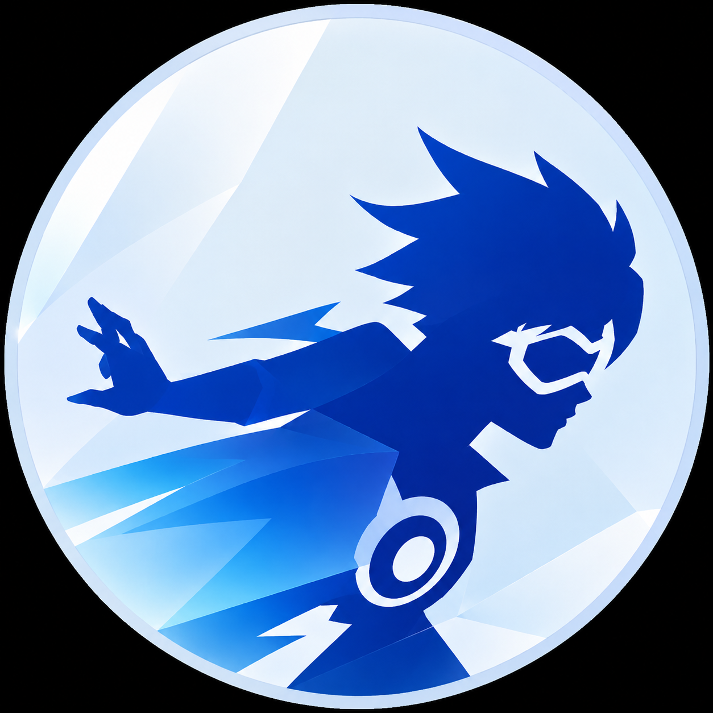

# 시간을달리는소녀 · OWKR Gather Bot

Discord 안에서 OWKR 내전 모집을 열고, 참가 신청과 티어 작성 여부를 확인하고, 시작 전에 음성 대기실 입장을 안내하는 봇입니다.

**[OWKR Discord](https://discord.gg/overwatchkr) · [내전 참가 안내](https://overwatch-kr.github.io/owkr-docs/participation) · [봇 정책·지원](https://overwatch-kr.github.io/owkr-docs/gather-bot)**

## 내전에 참가하기

1. 내전 모집 공지에 ✅를 누릅니다. 먼저 신청한 10명은 확정 참가자이고, 이후 신청은 대기열에 들어갑니다.
2. 모집이 완료되면 해당 내전의 티어 안내 메시지에 답장합니다. 순서는 **배틀태그 / 탱커 / 딜러 / 힐러**입니다.
3. 공지에 표시된 음성 대기실에 입장합니다. 시작 10분 전까지 입장하지 않은 확정 참가자에게 봇이 안내합니다.

한 번 모집이 완료된 뒤 자리가 비면 관리자가 대타 모집을 엽니다. 정해진 시각까지 10명이 한 번도 모이지 않은 내전은 관리자가 취소 시각을 지정한 경우 자동으로 취소됩니다.

## 운영진 기능

| 명령 | 할 수 있는 일 |
| --- | --- |
| `/내전` | 시작 시각과 일정을 확인하고 모집을 엽니다. |
| `/티어현황` | 참가·대기 인원과 확정 참가자의 티어 작성 여부를 확인합니다. |
| `/내전대타` | 확정 참가자가 빠진 내전의 대타를 모집합니다. |
| `/내전취소` | 선택한 내전을 확인하고 취소합니다. |
| `/경고` | 운영진이 결정한 경고를 조회하거나 기록·정정합니다. |

참가자는 `/개인정보`에서 보관·문의 안내를 확인하고 본인이 작성한 티어 기록을 삭제할 수 있습니다.

## 관련 OWKR 서비스

- [OWKR Match](https://github.com/Overwatch-KR/owkr-balance) · 내전 팀 편성
- [OWKR 문서](https://overwatch-kr.github.io/owkr-docs/) · 내전 규칙과 참가 안내
- [OWKR 관리자 시험](https://owkr-exam.vercel.app/) · 내전 운영진 선발 시험
- [OWKR 내전 워크샵](https://github.com/Overwatch-KR/owkr-scrim-workshop) · 사용자 지정 게임 모드 준비 중
